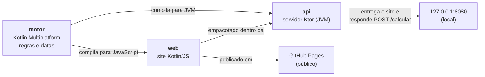

# Calculadora Penal

Site que estima as datas de **progressão de regime**, **livramento condicional** e **término da pena** na execução penal brasileira. Foi feito em Kotlin, num projeto de extensão do Instituto Mauá de Tecnologia em parceria com o escritório **Cespedes Lourenço Advogados**.

**Acesse:** https://rapha-v.github.io/calculadora-penal/

> O resultado é uma **estimativa** e não substitui a análise de um advogado. As datas podem variar alguns dias e não consideram a remição futura nem os requisitos subjetivos (como o comportamento), que são analisados pelo juiz.

---

## 1. Descrição geral

A execução penal brasileira é regida por leis complexas, alteradas várias vezes (Pacote Anticrime em 2019 e duas leis em 2026). Para quem não é da área, principalmente familiares de apenados, é difícil saber quando cabe cada benefício.

A Calculadora Penal recebe os dados da condenação e mostra, numa linha do tempo, as datas previstas para:

- progressão ao regime **semiaberto**;
- progressão ao regime **aberto**;
- **livramento condicional**, ou o motivo de ele não caber;
- **término da pena**.

O sistema também cumpre o objetivo institucional do escritório: depois do resultado, o usuário pode enviar o cálculo e os dados de contato ao escritório pelo **WhatsApp**, pelo botão "Quero Falar com um Advogado".

**Público-alvo:** familiares de apenados, cidadãos leigos e estudantes de Direito (nível introdutório).

## 2. Arquitetura do sistema

O projeto é um build Gradle com **três módulos**. Todo o código é Kotlin, e o JavaScript do site é gerado pelo compilador.



| Módulo | O que é | Pasta |
|---|---|---|
| `motor` | Regras jurídicas e cálculo de datas. Escrito uma vez, em `commonMain`, e compilado para **JVM** (usado pela API) e para **JavaScript** (usado pelo site). | `motor/src/commonMain/kotlin` |
| `web` | Site estático: formulário, linha do tempo do resultado e contato pelo WhatsApp. | `web/src/jsMain` |
| `api` | API REST em Ktor. Entrega o **mesmo site** e calcula no servidor (`POST /calcular`). | `api/src/main/kotlin` |

**Um site, dois modos de cálculo.** O `index.html` traz a marca `<meta name="modo" content="navegador">`:

- no **GitHub Pages**, a marca chega como está, e o site **calcula no próprio navegador**, sem servidor;
- na **API**, o Ktor troca a marca para `"api"` antes de entregar a página, e o site passa a **pedir o cálculo ao servidor** (`POST /calcular`).

Como o motor é o mesmo nos dois modos, as datas são idênticas. O resultado informa onde foi calculado: "Calculado no seu navegador" ou "Calculado pelo servidor (API Kotlin)".

**Sem banco de dados**, por decisão do projeto: nenhum dado do usuário é armazenado. O contato vai direto ao escritório numa mensagem de WhatsApp.

## 3. Fluxo operacional

**Pelo usuário:**

1. Preenche pena total, data do fato, início do cumprimento, tipo de crime, reincidência, regime inicial, detração e remição.
2. Clica em **Calcular**. O sistema valida os dados e escolhe a lei pela **data do fato**.
3. Vê as datas numa linha do tempo, em ordem cronológica. Datas que já passaram aparecem como "já atingida".
4. Se quiser, preenche nome, WhatsApp, e-mail e número do processo e clica para falar com um advogado. Abre o WhatsApp do escritório com o resultado na mensagem.

**Pelos dados:**

```
Formulário → validação → motor: legislacaoAplicavel(dataDoFato)
                               → frações de progressão e livramento
                               → datas a partir do início (recuado pela detração e remição)
          → Resultado → linha do tempo na tela + texto da mensagem do WhatsApp
```

No modo API, o passo "motor" acontece no servidor: o site envia um JSON, o Ktor converte em `Entrada`, chama o mesmo `calcular()` e devolve um JSON com as datas. Se os dados forem inválidos, o servidor devolve **400** com a mensagem do motor, e o site mostra o mesmo texto de erro do modo navegador.

## 4. Funcionalidades principais

- Cálculo das datas de **progressão** (semiaberto e aberto), **livramento condicional** e **término da pena**.
- Escolha automática da **lei aplicável pela data do fato**, para fatos a partir de 26/07/1990 (a lei penal mais grave não retroage).
- **Regime inicial** fechado ou semiaberto (no semiaberto há uma única progressão).
- **Detração** (prisão provisória) e **remição** (trabalho ou estudo), que contam como pena cumprida.
- **Validações:** pena zerada, valores negativos, detração somada à remição maior que a pena, início antes do fato, data do fato no futuro, datas inexistentes.
- Indicação de quando o livramento **não cabe** e por quê (pena menor que 2 anos, ou vedado no hediondo com morte).
- **Contato pelo WhatsApp** com o resultado já na mensagem, e máscara do número do processo no padrão do CNJ (`NNNNNNN-DD.AAAA.J.TR.OOOO`).
- Layout pensado primeiro para o **celular**, contraste conforme a **WCAG AA**, foco visível, `aria-live` no resultado e campos de data nativos.
- **API REST** local com o mesmo motor e script `rodar-api.bat` para iniciar com dois cliques.
- **44 testes automatizados** (38 do motor, rodados na JVM e em JavaScript, e 6 da API).

### Regras de cálculo

**Frações de progressão** (art. 112 da LEP), na forma primário / reincidente:

| Fato a partir de | Lei | Comum | Violência ou grave ameaça | Hediondo | Hediondo com morte |
|---|---|---|---|---|---|
| 26/07/1990 | 8.072/1990 * | 1/6 | 1/6 | 1/6 | 1/6 |
| 29/03/2007 | 11.464/2007 | 1/6 | 1/6 | 2/5, 3/5 | 2/5, 3/5 |
| 23/01/2020 | 13.964/2019 (Pacote Anticrime) | 16%, 20% | 25%, 30% | 40%, 60% | 50%, 70% |
| 25/03/2026 | 15.358/2026 | 16%, 20% | 25%, 30% | 70%, 80% | 75%, 85% |
| 08/05/2026 | 15.402/2026 | 1/6, 20% | 25%, 30% | 70%, 80% | 75%, 85% |

\* A redação original da Lei 8.072 vedava a progressão nos crimes hediondos. O STF declarou essa vedação inconstitucional (HC 82.959/2006; Súmula Vinculante 26), e a Súmula 471 do STJ manda aplicar 1/6 a esses fatos.

**Livramento condicional** (art. 83 do CP): 1/3 da pena para primário, 1/2 para reincidente e 2/3 no hediondo. No hediondo com resultado morte, é **vedado** para fatos a partir do Pacote Anticrime. Exige pena total de pelo menos 2 anos.

**Como as datas são contadas:**

- **Benefícios:** início + dias da fração, com 365 dias por ano e 30 por mês, truncando a fração. Conferido com o exemplo do manual da VEC.
- **2ª progressão:** a mesma fração, aplicada ao saldo da pena e contada a partir da 1ª progressão.
- **Término da pena:** início + pena pelo calendário real, menos 1 dia (art. 10 do CP).
- **Detração e remição:** recuam a data de início. Só a detração é comparada com a data do fato, porque a remição é ganha durante o cumprimento.

### Premissas e limitações

Premissas adotadas sem confirmação formal do escritório:

- 30 dias por mês na conversão da pena;
- início da vigência da Lei 15.358/2026 em 25/03/2026;
- detração aplicada recuando o início, sem contar prisão provisória anterior ao fato;
- número do WhatsApp e texto da mensagem, conforme a documentação do escritório.

Limitações:

- Não verifica requisitos subjetivos (comportamento etc.) nem reincidência **específica**.
- Não calcula remição futura: o usuário informa os dias já declarados pelo juiz.
- O usuário informa a pena **total**, somando todas as condenações (art. 84 do CP).
- O tipo de crime deve ser o da **época do fato**: alguns crimes só viraram hediondos depois de 1990, como o homicídio qualificado (Lei 8.930/1994).
- Fatos anteriores a 26/07/1990 não são calculados.
- Diferença de 1 dia no livramento em relação à calculadora de referência indicada pelo escritório: 730 contra 729 dias, no caso de 6 anos a partir de 27/10/2026.
- O formato dos campos de data (dd/mm/aaaa ou mm/dd/aaaa) segue o idioma do navegador.

## 5. Tecnologias utilizadas

| Tecnologia | Versão | Uso |
|---|---|---|
| Kotlin (Multiplatform, JVM e JS) | 2.4.20 | toda a aplicação |
| kotlinx-datetime | 0.8.0 | datas (`LocalDate`) no motor, no site e na API |
| kotlinx-coroutines | 1.11.0 | espera da resposta da API no site, sem travar a página |
| Ktor (servidor Netty) | 3.6.0 | API REST |
| kotlinx.serialization | (plugin do Kotlin 2.4.20) | conversão JSON ↔ classes na API |
| kotlin.test e Ktor test host | — | testes automatizados |
| Gradle (wrapper) | 9.7.1 | build multi-módulo, catálogo de versões em `gradle/libs.versions.toml` |
| JDK (Eclipse Temurin) | 21 | compilação e execução da API |
| HTML e CSS | — | estrutura e visual do site |
| Git, GitHub, GitHub Actions e GitHub Pages | — | versionamento, CI/CD e hospedagem |

## 6. Infraestrutura de execução

| Parte | Onde roda | Observação |
|---|---|---|
| Site público | **GitHub Pages** (hospedagem estática, gratuita, com HTTPS) | O cálculo acontece no navegador de quem acessa; não há servidor. |
| API | **Localmente**, em `127.0.0.1:8080` (Netty) | Só o próprio computador acessa (endereço de loopback). |
| CI/CD | **GitHub Actions** (`.github/workflows/publicar-site.yml`) | A cada push na `main`, roda `:motor:allTests :api:test :web:jsBrowserDistribution`. Se algum teste falhar, o site **não** é publicado. O workflow usa permissões mínimas. |

Não há banco de dados nem contêiner: o projeto não armazena dados, e o site estático dispensa servidor.

## 7. Configuração do ambiente e execução

**Requisitos:**

- **JDK 21** (recomendado: Eclipse Temurin 21);
- **Git**, para baixar o projeto;
- Gradle, Kotlin e as bibliotecas **não precisam ser instalados**: o `gradlew` baixa tudo na primeira execução.

**Baixar:**

```
git clone https://github.com/rapha-v/calculadora-penal.git
cd calculadora-penal
```

Os comandos abaixo são para o PowerShell do Windows. No Linux ou macOS, troque `.\gradlew.bat` por `./gradlew`.

| O quê | Comando |
|---|---|
| Rodar os testes | `.\gradlew.bat :motor:allTests :api:test` |
| Site local, calculando no navegador | `.\gradlew.bat :web:jsBrowserDevelopmentRun` (Ctrl+C para parar) |
| API, com o site calculando no servidor | `.\gradlew.bat :api:run` e abrir http://127.0.0.1:8080 |
| API com dois cliques (Windows + Chrome) | `rodar-api.bat`: sobe a API, espera responder e abre o Chrome |
| Pacote da API para outro computador | `.\gradlew.bat :api:distZip`, depois descompactar `api/build/distributions/api.zip` e rodar `bin\api.bat` (requer Java 21 ou mais novo) |

> O site local e a API usam a mesma porta (8080): não rode os dois ao mesmo tempo.
> A primeira execução da API demora mais, porque ela gera o site de produção antes.

**Testar a API pelo terminal** (PowerShell):

```powershell
Invoke-RestMethod -Method Post -Uri http://127.0.0.1:8080/calcular -ContentType "application/json" `
  -Body '{"anos":6,"dataDoFato":"2025-06-01","inicio":"2026-10-27","tipo":"COMUM"}'
```

## 8. Endpoints da API

URL base: `http://127.0.0.1:8080`

| Método | Endpoint | Descrição |
|---|---|---|
| GET | `/` | Entrega o site, marcado para calcular pela API. |
| GET | `/web.js` | Script do site (Kotlin compilado para JavaScript). |
| POST | `/calcular` | Recebe os dados da condenação em JSON e devolve as datas. |

### `POST /calcular`

**Campos de entrada:**

| Campo | Tipo | Obrigatório | Descrição |
|---|---|---|---|
| `anos`, `meses`, `dias` | inteiro | `anos` sim; os outros têm padrão 0 | pena total |
| `dataDoFato` | texto `aaaa-mm-dd` | sim | data do crime (define a lei aplicável) |
| `inicio` | texto `aaaa-mm-dd` | sim | início do cumprimento |
| `tipo` | `COMUM`, `VIOLENCIA_OU_GRAVE_AMEACA`, `HEDIONDO`, `HEDIONDO_COM_MORTE` | sim | tipo de crime |
| `reincidente` | booleano | não (padrão `false`) | reincidência |
| `regimeInicial` | `FECHADO`, `SEMIABERTO` | não (padrão `FECHADO`) | regime fixado na sentença |
| `detracaoDias` | inteiro | não (padrão 0) | dias de prisão provisória |
| `remicaoDias` | inteiro | não (padrão 0) | dias já remidos |

**Exemplo de requisição:**

```json
{
  "anos": 6,
  "dataDoFato": "2025-06-01",
  "inicio": "2026-10-27",
  "tipo": "COMUM"
}
```

**Resposta 200:**

```json
{
  "legislacao": "PACOTE_ANTICRIME",
  "progressaoSemiaberto": "2027-10-12",
  "progressaoAberto": "2028-08-01",
  "livramento": "2028-10-26",
  "terminoDaPena": "2032-10-26"
}
```

- `legislacao` assume um destes valores: `LEI_8072`, `LEI_11464`, `PACOTE_ANTICRIME`, `LEI_15358` ou `LEI_15402`.
- `progressaoSemiaberto` é `null` quando o regime inicial já é o semiaberto.
- `livramento` é `null` quando não cabe (pena menor que 2 anos, ou hediondo com morte a partir do Pacote Anticrime).

**Resposta 400** (dados inválidos), sempre no formato `{"erro": "..."}`:

```json
{ "erro": "O início do cumprimento (já descontada a detração) não pode ser anterior à data do fato" }
```

```json
{ "erro": "JSON inválido ou campo obrigatório faltando" }
```

## 9. Componentes do grupo

| Função | Nome |
|---|---|
| Desenvolvimento (projeto individual) | Raphael Vitor Arai |
| Orientação | Prof. Dr. Aparecido V. de Freitas — Instituto Mauá de Tecnologia |
| Empresa parceira | Cespedes Lourenço Advogados |

## 10. Futuras melhorias (roadmap)

- **API na internet:** hospedar num serviço em nuvem, escutando em `0.0.0.0`, com HTTPS e proteção contra abuso (limite de requisições).
- **Aplicativo Android** usando o mesmo motor (Kotlin Multiplatform).
- **Reincidência específica** e frações especiais (por exemplo, a progressão especial da gestante, no art. 112, § 3º, da LEP).
- **Cálculo de remição** a partir de dias trabalhados e horas de estudo.
- **Tipo de crime pela data de tipificação**, avisando quando o crime ainda não era hediondo na data do fato.
- **Relatório em PDF** do cálculo para o usuário guardar.
- **Domínio próprio** do escritório e tags Open Graph para a prévia do link no WhatsApp.
- **Testes de interface** do site no navegador.

## 11. Referências

**Legislação e jurisprudência**

- Decreto-Lei nº 2.848/1940 — Código Penal (arts. 10, 42, 83 e 84)
- Lei nº 7.210/1984 — Lei de Execução Penal (arts. 112, 126 e 128)
- Lei nº 8.072/1990 — Crimes Hediondos
- Lei nº 11.464/2007
- Lei nº 13.964/2019 — Pacote Anticrime
- Lei nº 15.358/2026 e Lei nº 15.402/2026
- STF: HC 82.959/SP (2006) e Súmula Vinculante 26
- STJ: Súmula 471
- Textos das leis: [Planalto](https://www.planalto.gov.br/)

**Material do projeto**

- Documentação: Aplicativo Calculadora Penal, v1.3 (Cespedes Lourenço Advogados)
- Manual de Cálculo da VEC (exemplos usados para conferir as datas)
- Especificação do Projeto de Extensão — Desenvolvimento de Aplicativos com a Linguagem Kotlin (Instituto Mauá de Tecnologia)

**Documentação técnica**

- [Kotlin](https://kotlinlang.org/docs/home.html) · [Kotlin Multiplatform](https://kotlinlang.org/docs/multiplatform.html)
- [Ktor](https://ktor.io/docs/)
- [kotlinx-datetime](https://github.com/Kotlin/kotlinx-datetime) · [kotlinx.coroutines](https://github.com/Kotlin/kotlinx.coroutines)
- [GitHub Pages](https://docs.github.com/pages) · [GitHub Actions](https://docs.github.com/actions)
- [WCAG 2.1](https://www.w3.org/TR/WCAG21/)
